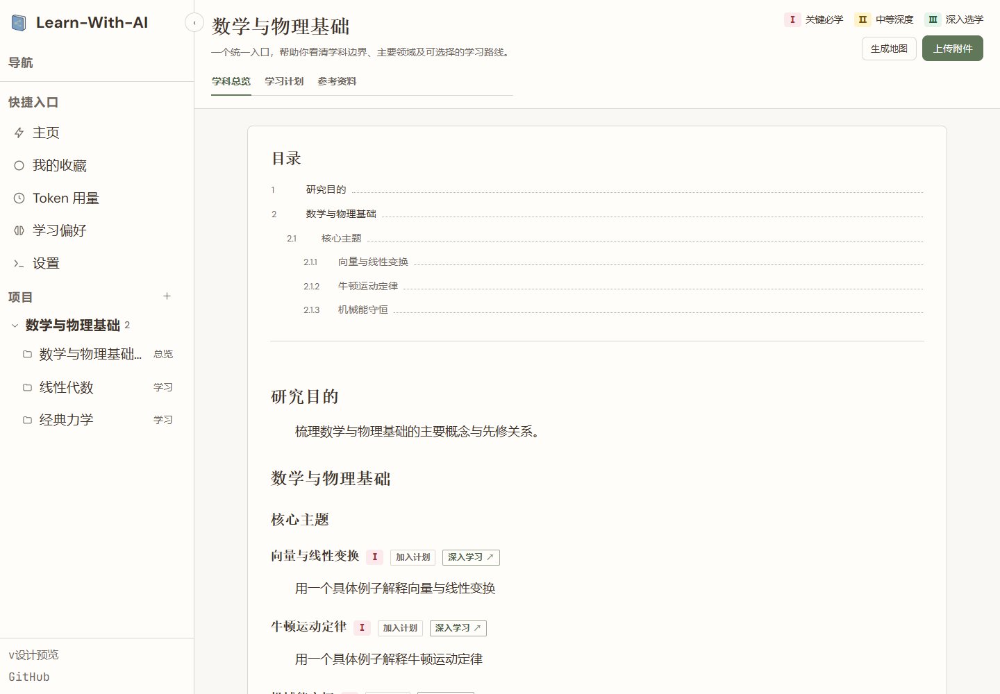
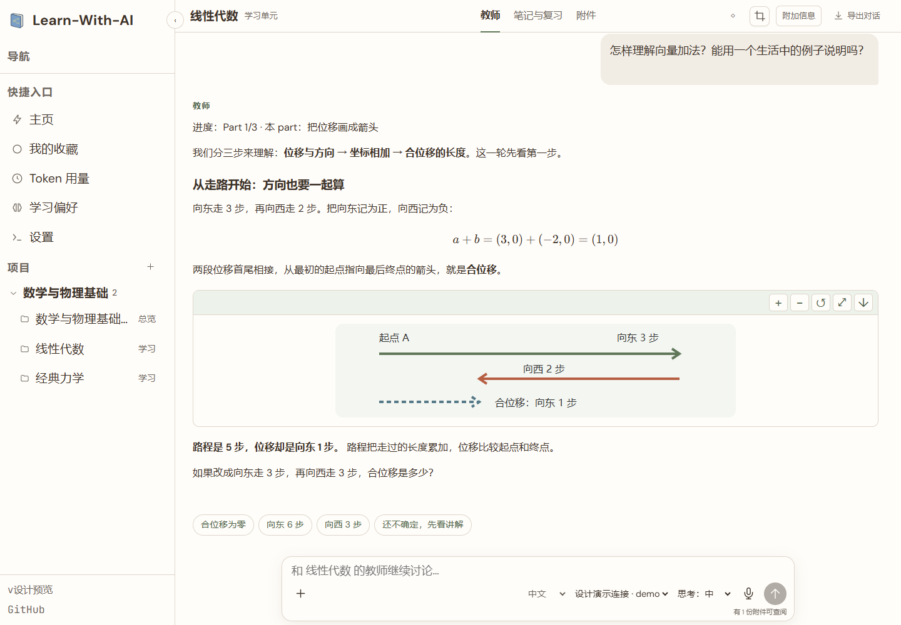
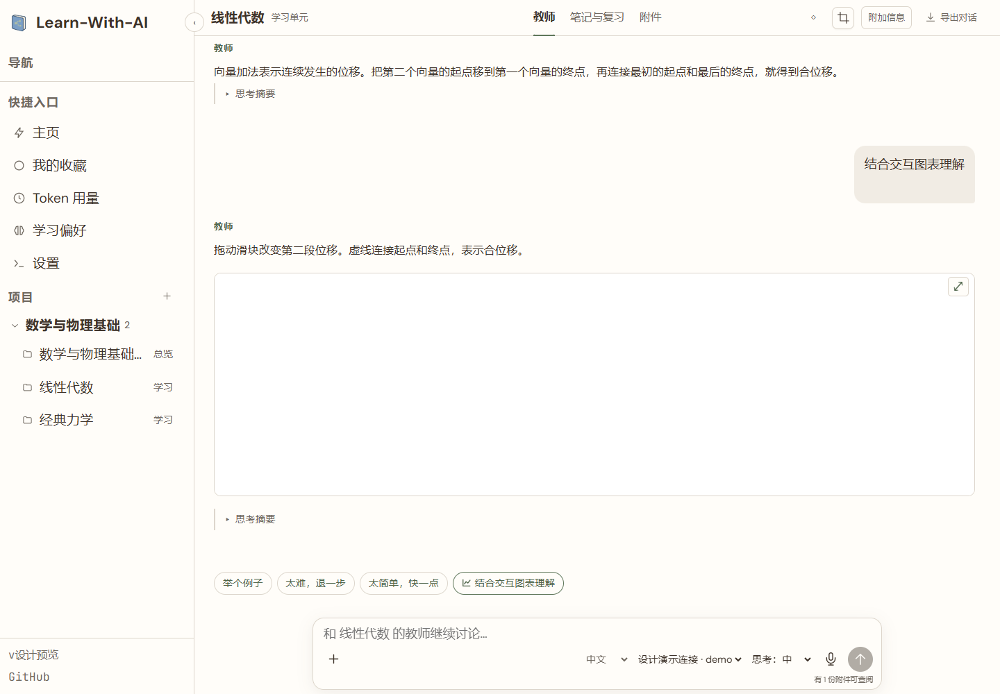
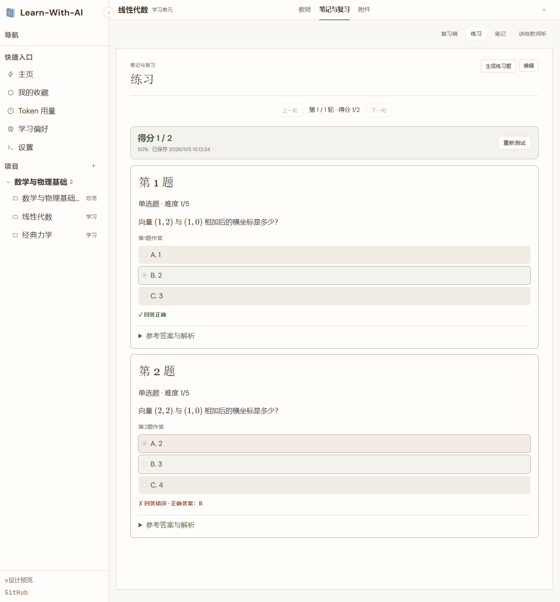
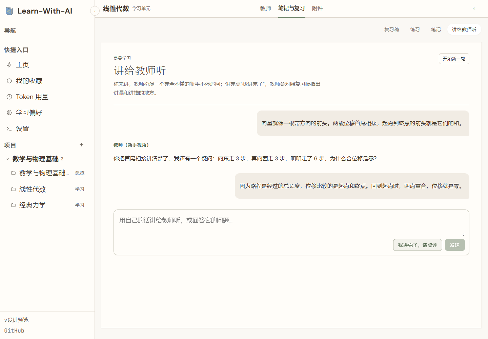
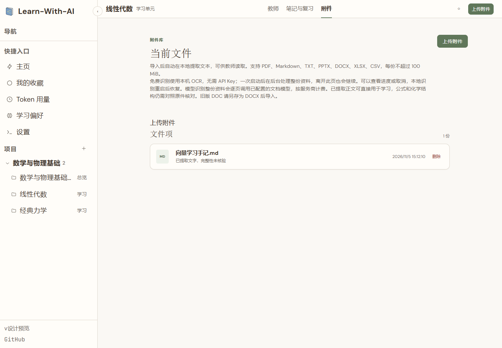
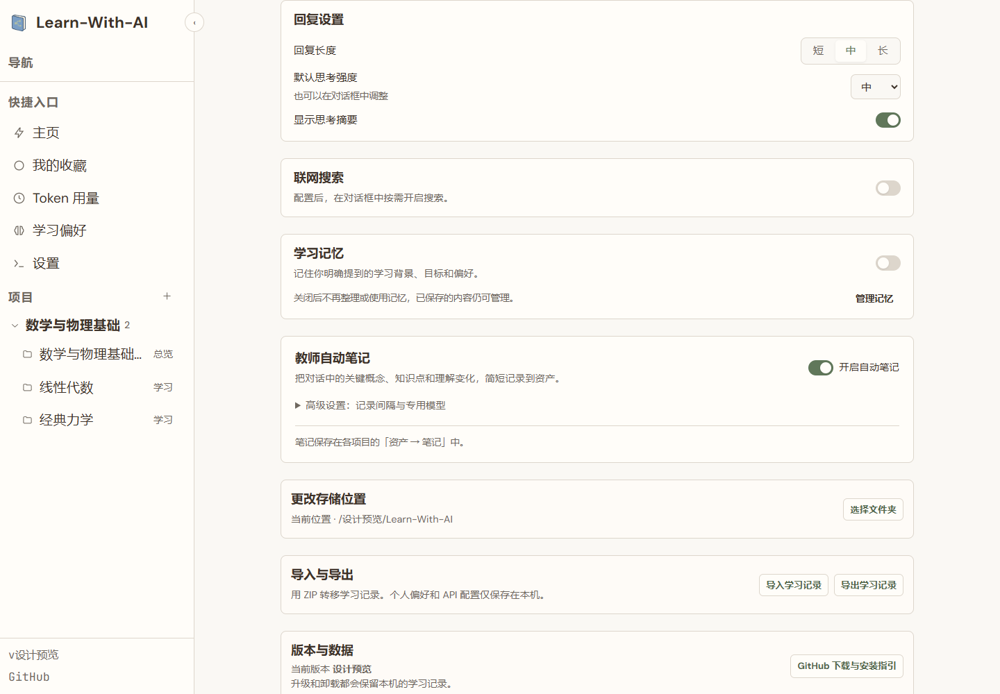
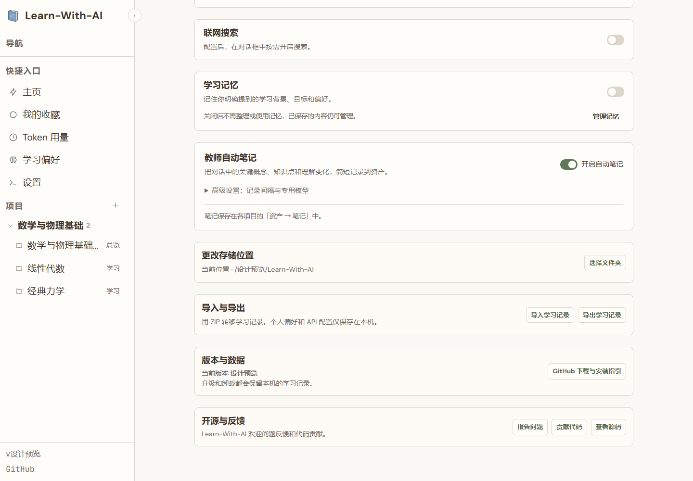

<div align="center">


# Learn-With-AI — Local-first AI Learning App

[简体中文](./README.md) · English

**Learn-With-AI is an open-source, local-first AI learning app for Windows, macOS and Linux.**

Build a subject knowledge map, explore concepts with formulas and interactive diagrams, and check your understanding with notes, quizzes and teach-back practice.

[](https://github.com/porridgeowefish/Learn-With-AI/releases/latest)
[](https://github.com/porridgeowefish/Learn-With-AI/actions/workflows/ci.yml)
[](./LICENSE)

**[Download for Windows, macOS and Linux](https://github.com/porridgeowefish/Learn-With-AI/releases/latest)** · [Product website](https://porridgeowefish.github.io/Learn-With-AI/en/) · [Quick start](#quick-start) · [Screenshots](#the-learning-workflow) · [Build from source](#build-from-source)

[Gitee repository](https://gitee.com/szu-andrew/learn-with-ai) · [Gitee releases](https://gitee.com/szu-andrew/learn-with-ai/releases)

The bundled example needs no API key. New conversations and generated content require a configured model connection; provider charges may apply.

</div>

## What can I do with it?

Learn-With-AI is a desktop study workspace for moving from reading an explanation to explaining it yourself. Start with a question or bring your own textbook, lecture notes or slides.

| Learning task | What the app provides |
| --- | --- |
| Find a starting point | Subject maps with topic relationships, prerequisites and learning priorities |
| Understand a concept | AI tutor conversations with text, formulas, tables, diagrams and interactive examples |
| Study your own materials | PDF, Markdown, TXT, PPTX, DOCX, XLSX and CSV import, local parsing and source references |
| Work with scanned pages | Local OCR where supported by the operating system; check formulas against the original |
| Keep useful explanations | Automatic notes, HTML review guides from learning conversations, text annotations and Yuanbao Search |
| Test your understanding | Generated quizzes with objective-question scoring, answers and explanations |
| Keep a formula in view while reading an explanation | In the Windows app's Teacher view, use the crop icon beside Additional Information to capture any visible app area; resize or move the temporary card, then close it when done |
| Explain it yourself | Teach-back practice: explain a concept and let the tutor ask follow-up questions |
| Collect small discoveries | Start with an empty collection, receive a random gem after your first completed exchange, then discover 50 gems and shells through learning. View owned treasures in 3D; deleting their source conversation keeps the collection |
| Adjust how you learn | Part-based teaching, optional understanding checks, reply length, supported reasoning levels, five themes and four font sizes |
| Use search and memory by choice | Configure and verify web search before enabling it in a conversation; optional learning memory with source references, editing and deletion |
| Move your study workspace | Change storage location or import/export learning records as ZIP; personal preferences, API configuration and learning memory stay private and are excluded from ZIP exports |
| Update from Gitee (current source) | Automatic version checks, download progress, cancellation and retry; registered Windows MSI installations can install and restart from Settings. Other systems and portable builds use the installer download link |

The Gitee updater ships with v0.8.15. Existing v0.8.14 and earlier installations need one manual installation of v0.8.15 or later. This release publishes packages on GitHub; Gitee receives source and tags only. Until Gitee packages are published, the updater reports that no official release is available. Live Gitee download and complete upgrade verification follow separately.

Learning files stay on your computer. You choose the model connection, including OpenAI- and Anthropic-compatible APIs. Local-first describes storage and local processing; model generation can use a remote service.

## Quick start

1. Download an installer from [Releases](https://github.com/porridgeowefish/Learn-With-AI/releases/latest).
2. Open the app and choose the bundled example (`体验示例`). Explore the gradient-descent example, review and quizzes without an API key. The example uses preset content and resets when closed.
3. To create your own learning content, configure an OpenAI- or Anthropic-compatible API connection in Settings (`设置`), or sign in with a ChatGPT plan. Available models and quotas depend on the provider and plan.
4. Create a learning unit for a question, or a subject map for a broader field. Import your reference material if needed.

This guide is in English. Current screenshots and the bundled example use Chinese; this page does not promise a fully translated app interface.

| System | Package | How it opens |
| --- | --- | --- |
| Windows 10/11 x64 or ARM64 | `…-windows-<arch>.msi` | Native window; requires Microsoft WebView2 Runtime |
| macOS Intel or Apple Silicon | `…-darwin-<arch>.pkg` or `…-app.tar.gz` | Local interface in your default browser |
| Debian / Ubuntu | `…-linux-<arch>.deb` | Install with `sudo apt install ./package.deb` |
| Other Linux distributions | `…-linux-<arch>-install.tar.gz` | Extract and run `./install.sh` |

Choose `amd64` for x64 or `arm64` for ARM. Release packages include the frontend, backend and document parser; end users do not need Go, Node.js, Python or Office. Releases include `SHA256SUMS` for download verification. Windows packages are currently unsigned and may trigger a system warning; verify the official download source.

## The learning workflow

**Bring material → map the subject → explore → review → practise → teach it back.**

Screenshots were refreshed on November 5, 2026 using the current product components in an isolated design preview. Projects, materials, conversations, scores and treasures are demo data, not live model results. The examples cover vectors and displacement. Generated explanations and visualizations depend on the model and the question.

### 1. See where a topic fits

Build a map around a subject or around the recognized text from your materials. Select a topic to add it to a plan or open a learning unit.



### 2. Explore ideas with the tutor

Ask for a new example, missing prerequisites or a visual explanation. Supported output includes mathematical notation, Mermaid diagrams, SVG illustrations and interactive HTML. Built-in JSXGraph controls can display 2D functions and rotatable 3D surfaces.

The tutor marks the current teaching position as Part i/N. Optional multiple-choice checks allow uncertainty or skipping; learners can also type freely. Teaching progress is not a mastery score.





The interactive screenshot uses preset HTML in the real renderer, without a model request.

### 3. Review and check your understanding

Keep notes and generate an HTML review from your learning conversations. Select text to annotate it or look it up with Yuanbao Search. Attempt a quiz before revealing the answers and explanations. In teach-back practice, explain the idea in your own words and ask for feedback.





### 4. Manage materials, settings and discoveries

Local OCR can process an entire document in the background, continue after leaving the page, and resume local work after restart. You can inspect progress or cancel. Optional cloud recognition makes per-page provider calls and may incur charges. Verify formulas against the original.



Choose reply length, supported reasoning effort and whether to display the provider's reasoning summary. Web search is off by default and requires configuration and verification. Learning memory is also off by default; when enabled, it extracts explicit background, goals and preferences from new learner messages. It does not scan past conversations. Saved memories remain manageable after disabling the feature.



Change storage location or transfer learning records as ZIP. Restart the app after a successful move; conflicting project names are reported during import.




## Data and model boundaries

- Projects, conversations, imported materials, notes and configuration are stored as ordinary local files. Updates and uninstalling preserve learning data.
- The app does not require an account with a Learn-With-AI cloud service. Live tutoring and generation need a working connection to the model provider you select.
- Local parsing and local OCR do not upload documents. Tutoring, generation, web search, memory extraction and optional cloud recognition send the necessary content to the relevant configured services.
- Model output, quiz answers and OCR can be wrong. Check important claims and formulas against your sources.
- API connection keys are stored in `config.local.json`; search configuration and learning memory are in `learning-profile.json`. These local files are not encrypted. Do not commit or share them in an issue.

Default data locations: Windows `%LOCALAPPDATA%\learn-with-ai`; macOS `~/Library/Application Support/learn-with-ai`; Linux `$XDG_DATA_HOME/learn-with-ai` or `~/.local/share/learn-with-ai`. The full path is shown in Settings. On Windows, closing the window hides it to the tray; use the tray menu to exit.

## Build from source

Requires Go ≥ 1.26 and Node.js ≥ 20.19.

```bash
git clone https://github.com/porridgeowefish/Learn-With-AI.git
cd Learn-With-AI
npm install --prefix frontend
npm run build
npm run start
```

The source server opens `http://127.0.0.1:8787/`. Development data defaults to the ignored `workspace/` directory. Set `--workspace` or `LWA_WORKSPACE_ROOT` to choose another location. The backend uses Go. The frontend uses React 18, TypeScript and Vite. See the [Chinese guide](./README.md#从源码构建) for development commands.

You can also clone `https://gitee.com/szu-andrew/learn-with-ai.git` and run the same build steps from the `learn-with-ai` directory.

## Feedback and contributions

Previous repository links redirect to the current Learn-With-AI repository.

[Report a bug or suggest an improvement](https://github.com/porridgeowefish/Learn-With-AI/issues). Include the app version, operating system and steps to reproduce the problem; remove keys and private learning content. See [CONTRIBUTING.md](./CONTRIBUTING.md) for the contribution workflow.

The project uses GitHub and Gitee for version management and releases. Maintainer uploads synchronize branches, version tags and release content across both services. You can also report issues on [Gitee](https://gitee.com/szu-andrew/learn-with-ai/issues).

If this workspace helps your learning, a Star makes it easier to find again. A concrete example of what worked or where you got stuck is also welcome.

[MIT](./LICENSE) © 2026 Xiong Minzhe
